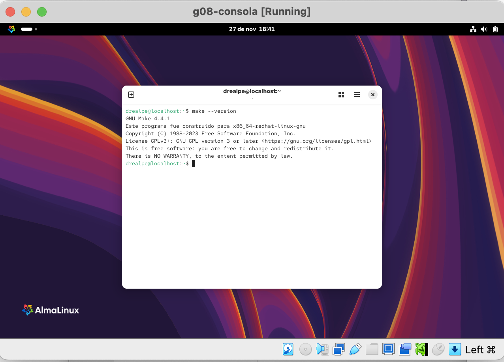
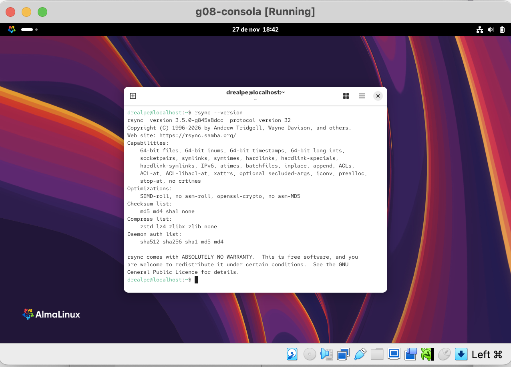
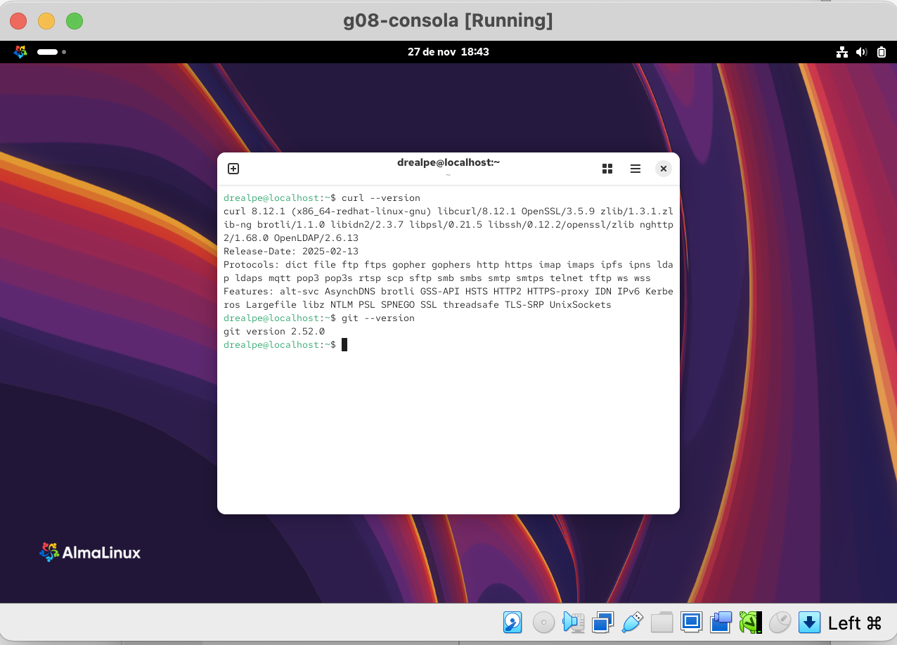
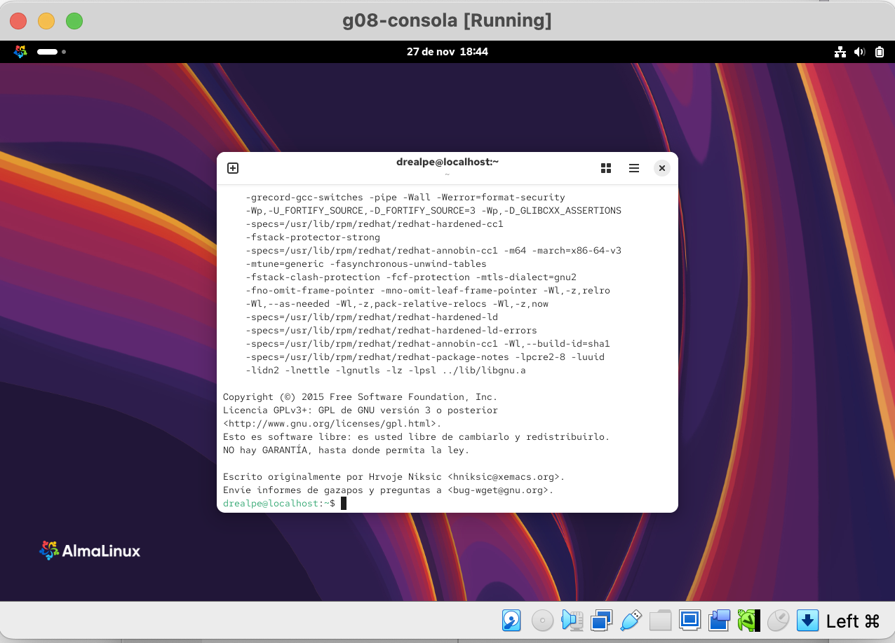

# Sprint 1 | Montaje de máquinas virtuales

[Volver al inicio]([https://github.com/sebs-rl/proyecto-so-g08](https://github.com/sebs-rl/proyecto-so-g08))

- **Grupo:** 08.
- **Asignatura:** Sistemas Operativos.
- **Universidad:** Universidad del Valle, sede Yumbo.
- **Distribución gráfica:** Pop!_OS.
- **Distribución de consola:** AlmaLinux.
- **Puntos del sprint:** VM gráfica, VM de consola, red, SSH e instantáneas.
- **Entregables:** evidencias, comandos utilizados y video de 3 minutos.

## 1. VM gráfica (g08-grafica)

### Pop!_OS

Para la máquina virtual gráfica utilizamos Pop!_OS 26.04 LTS, una distribución de Linux que cuenta con el entorno de escritorio COSMIC, el cual permite interactuar con el sistema mediante ventanas, aplicaciones y una terminal.

La máquina virtual fue creada en VirtualBox con el nombre `g08-grafica` y un disco virtual de 25 GiB. Durante la instalación realizamos el particionado manual del disco para separar los archivos del sistema operativo de los archivos personales del usuario.

### Particiones del disco

| **Partición** | **Tamaño** | **Función** |
|---|---|---|
| `/` (sda1) | 13,3 GiB | Almacena el sistema operativo y los programas instalados. |
| Swap (sda2) | 2 GiB | Funciona como memoria de intercambio y sirve de apoyo a la memoria RAM. |
| `/home` (sda3) | 9,7 GiB | Almacena los archivos personales y las configuraciones del usuario. |

Dos navegadores y dos editores instalados: Firefox y Chromium, nano y gedit.

Comandos: `lsblk`, `df -h`, `cat /etc/fstab`

### Particionado manual del disco

### Comandos de verificación del particionado

### Navegadores instalados

### Evidencia de editores de texto

## 2. VM de consola (g08-consola)

### AlmaLinux

|Particion|Tamaño|Funcion|
|---|---|---|
|/|5 GB|Espacio del sistema operativo base.|
|/var|10 GB|Almacenamiento de datos variables y futura utilización de Docker.|
|Swap|1 GB|Memoria de intercambio.|
|/home|1 GB|Archivos del usuario.|

Herramientas instaladas: make, rsync, curl, git y wget.

Comandos: `lsblk`, `df -h`, `cat /etc/fstab`, `make --version`, `rsync --version`, `curl --version`, `git --version`, `wget --version`

Salida de `lsblk` y `df -h`. Muestra el disco de 25 GB dividido manualmente en las particiones `/`, `/boot`, swap, `/home` y `/var`, con el tamaño y el espacio usado de cada una.

Salida de `cat /etc/fstab`. Confirma que las particiones creadas durante la instalación se montan automáticamente al arrancar el sistema.

Salida de `make --version`. Confirma que `make` quedó instalado y funcionando.

Salida de `rsync --version`. Confirma que `rsync` quedó instalado y funcionando.

Salida de `curl --version` y `git --version`. Confirma que ambas herramientas quedaron instaladas y funcionando.

Salida de `wget --version`. Confirma que `wget` quedó instalado y funcionando.

## 3. Red

Cada VM tiene dos adaptadores: el 1 en NAT (internet) y el 2 en red solo-anfitrión (para verse entre ellas).

Comandos: `ip a` en cada VM y `ping` en los dos sentidos.

**[Captura 6: ip a en las dos VMs, mostrando una dirección en cada interfaz]**

**[Captura 7: ping de la gráfica a la consola y de la consola a la gráfica]**

## 4. SSH

Entramos por SSH desde la VM gráfica a la VM de consola.

Comando: `ssh usuario@direccion-de-la-consola`

**[Captura 8: la sesión SSH abierta, con el prompt de la consola]**

## 5. Instantáneas

Una por VM, llamada `instalacion-limpia`, tomada con la VM apagada y la instalación terminada.

**[Captura 9: pestaña de instantáneas de g08-grafica]**

**[Captura 10: pestaña de instantáneas de g08-consola]**
