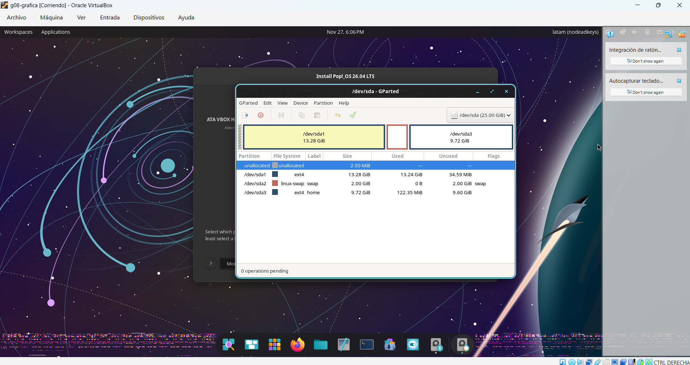
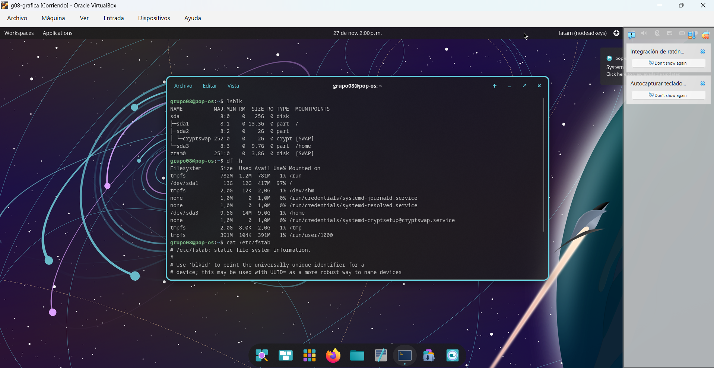
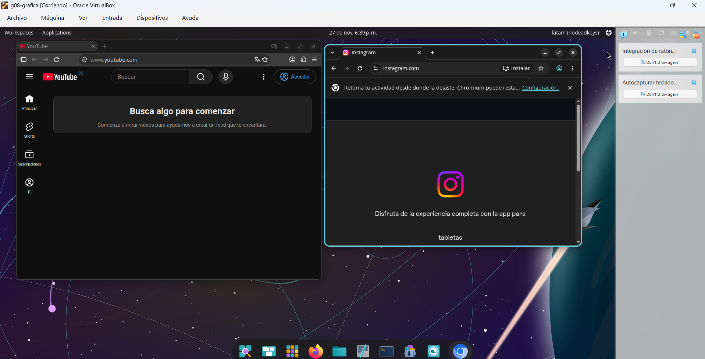
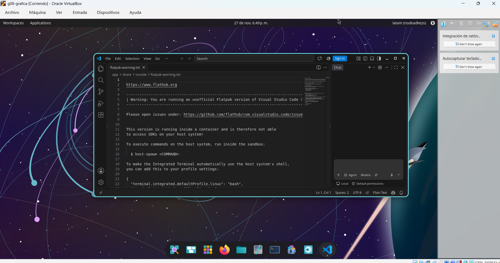

## Sprint 1 | Montaje de VMs

- **Qué se pide en este sprint (5 puntos):** VM gráfica, VM de consola, red, SSH e instantáneas.
- **Qué se entrega en el campus:** el enlace de este sitio de github.
- **Qué más:** el video de 3 minutos, 2 commits por integrante y el archivo `codigo_sprint1.txt` en el home del usuario principal de las dos Maquinas Virtuales.

## 1. VM gráfica (g08-grafica)

### Pop!_OS

Para la máquina virtual gráfica utilizamos Pop!_OS 26.04 LTS, una distribución de Linux que cuenta con el entorno de escritorio COSMIC, el cual permite interactuar con el sistema mediante ventanas, aplicaciones y una terminal.

La máquina virtual fue creada en VirtualBox con el nombre `g08-grafica` y un disco virtual de 25 GiB. Durante la instalación realizamos el particionado manual del disco para separar los archivos del sistema operativo de los archivos personales del usuario.

### Particiones del disco

| **Partición** | **Tamaño** | **Función** |
|---|---|---|
| `/` (sda1) | 13,3 GiB | Almacena el sistema operativo y los programas instalados. |
| Swap (sda2) | 2 GiB | Funciona como memoria de intercambio y sirve de apoyo a la memoria RAM. |
| `/home` (sda3) | 9,7 GiB | Almacena los archivos personales y las configuraciones del usuario. |

Dos navegadores y dos editores instalados: Firefox y Chromium, nano y gedit.

Comandos: `lsblk`, `df -h`, `cat /etc/fstab`

1. partituras 

2. comandos ejecutados 

3. los dos navegadores 

4. editor

## VM Grafica (g08-grafica)
### AlmaLinux

|Particion|Tamaño|Funcion|
|---|---|---|
|/|5 GB|
|/var|10 GB|
|Swap|1 GB|
|/home|1 GB|

Herramientas instaladas: make, rsync, curl, git y wget.

Comandos: `lsblk`, `df -h`, `cat /etc/fstab`, `make --version`, `rsync --version`, `curl --version`, `git --version`, `wget --version`

**[Captura 4: lsblk, df -h y cat /etc/fstab de g07-consola, con prompt y fecha]**

**[Captura 5: las cinco herramientas mostrando su versión]**

## 3. Red

Cada VM tiene dos adaptadores: el 1 en NAT (internet) y el 2 en red solo-anfitrión (para verse entre ellas).

Comandos: `ip a` en cada VM y `ping` en los dos sentidos.

**[Captura 6: ip a en las dos VMs, mostrando una dirección en cada interfaz]**

**[Captura 7: ping de la gráfica a la consola y de la consola a la gráfica]**

## 4. SSH

Entramos por SSH desde la VM gráfica a la VM de consola.

Comando: `ssh usuario@direccion-de-la-consola`

**[Captura 8: la sesión SSH abierta, con el prompt de la consola]**

## 5. Instantáneas

Una por VM, llamada `instalacion-limpia`, tomada con la VM apagada y la instalación terminada.

**[Captura 9: pestaña de instantáneas de g07-grafica]**

**[Captura 10: pestaña de instantáneas de g07-consola]**
